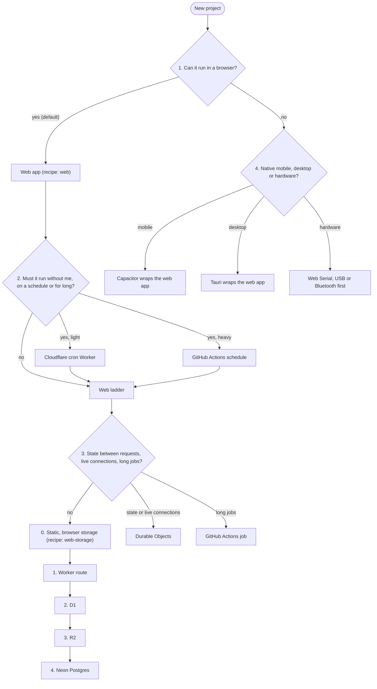

# Architecture decision tree

Walk it at kickoff. Take the first branch that fits and climb only as far as the project needs. Record the path, the recipes and the reasons in the project's DECISIONS.md.

Every project gets the [base](recipes/base/RECIPE.md) recipe. The table after the diagram links each node to its recipe.

| Node | Recipe |
| --- | --- |
| Every project | [base](recipes/base/RECIPE.md) |
| 1. Web app | [web](recipes/web/RECIPE.md), plus [pwa](recipes/pwa/RECIPE.md) when I will install it or use it offline |
| Rung 0: static, browser storage | [web-storage](recipes/web-storage/RECIPE.md) |
| 2. Cron Worker, Actions schedule | No recipe yet |
| 3. Durable Objects, long jobs | No recipe yet |
| Rungs 1 to 4: Worker route, D1, R2, Neon | No recipe yet |
| 4. Capacitor, Tauri, hardware | No recipe yet |

No recipe yet means: build from the notes below. When a second project needs the same files, turn the tested ones into a recipe.

## 1. Can it run in a browser?

Yes is the default. Recipe: [web](recipes/web/RECIPE.md). Vite, TypeScript, static files on Workers static assets, private behind Access. Requests for static assets are free and unlimited. Deviate only with a stated reason.

Add [pwa](recipes/pwa/RECIPE.md) when I will use the app from my phone's home screen or offline.

## 2. Does it need to run without me?

- Light work (under 10 ms CPU per run, under 50 subrequests): a Cloudflare cron Worker. The free plan allows 5 cron triggers per account, shared by every project. Track them in PROJECTS.md.
- Heavy work: GitHub Actions on a schedule, up to 6 hours per job. Private repos share 2,000 minutes a month across all projects. Linux minutes count 1x, Windows 2x, macOS 10x. Budget each job before adding it.
- Crawling arbitrary websites: the crawler runs in the project's own Actions, because sessions have limited network access. The job commits its output to the repo or a data branch with my commit identity. The session only reads that data.
- Results still go to the web dashboard.

## 3. Does it need what serverless can't do?

- State held between requests, or live connections (WebSockets): Durable Objects with SQLite storage. Free plan: 100,000 requests and 13,000 GB-s a day, 5 GB storage per account. Use the WebSocket Hibernation API.
- Long jobs: GitHub Actions, as in branch 2.
- Anything else here (a container, an always-on server) costs money. Stop and ask.

## 4. Must it run outside a browser?

- Mobile: wrap the web app with Capacitor. Android builds run on Linux runners; I sideload the APK. iOS builds need macOS runners (10x minutes) and an Apple Developer Program membership to install beyond a 7-day test build. That membership is paid: ask first.
- Desktop: wrap the web app with Tauri. Build each OS on its own runner with `tauri-apps/tauri-action`. Unsigned builds show OS warnings; signing certificates cost money: ask first.
- Hardware: try Web Serial, WebUSB or Web Bluetooth in Chrome first. Only if that fails, a local script or desktop tool.

Keep the web code free of platform calls outside `src/platform/`, so wrapping needs no rewrite.

### Platform limits

Cloud sessions run on Linux without Xcode. They cannot build or run native macOS or iOS apps, Capacitor's iOS target included. When an idea needs a native Apple platform, raise it with me and lay out the options instead of guessing:

- A local session on my Mac, which has Xcode.
- GitHub Actions macOS runners. They count 10x against the 2,000 shared minutes: about 200 macOS minutes a month.
- A web app, the pwa recipe, or a Tauri desktop build, if one of them covers the need.

There is no macOS or iOS recipe.

## Web ladder

Climb one rung at a time. Each rung needs a stated reason in the project README.

### 0. Static, browser storage (default)

Recipe: [web-storage](recipes/web-storage/RECIPE.md).

- Data in IndexedDB, not localStorage (about 5 MB cap). The recipe's `src/data/` does this with a versioned schema.
- Call `navigator.storage.persist()`. Browsers grant it silently by their own heuristics.
- Always ship export and import. Browser storage is per device and can be evicted: Safari deletes script-written data after 7 days of browser use without a visit, unless the app is installed to the home screen. An installed iOS web app has storage separate from Safari.
- Add the [pwa](recipes/pwa/RECIPE.md) recipe when I will install the app.
- Research and data projects live here too: compute results at build time into JSON in the bundle, and render charts, tables and a plain-language summary.

### 1. Worker route

For a secret, an API proxy, or small server logic. Add `"main"` to `wrangler.jsonc` and `"run_worker_first": ["/api/*"]` under `assets`, so static files stay free. Free plan: 100,000 requests a day, 10 ms CPU per request. Secrets: `wrangler secret put`, never in the repo or the frontend.

### 2. D1

For data shared across devices or people. Free plan: 10 databases, 500 MB each, 5 GB total, 5 million rows read and 100,000 rows written a day, 7 days of Time Travel. Schema changes go through `wrangler d1 migrations`, additive only. Bind Previews to a separate preview database, never production.

### 3. R2

For files. Free tier: 10 GB-month, 1 million Class A and 10 million Class B operations a month, free egress. R2 needs an R2 subscription with a payment method on file, even at zero usage. Ask me before the first project uses it. Until then, small files fit in D1 (2 MB per row).

### 4. Neon Postgres

When a project outgrows SQLite: over 500 MB, or needs Postgres features. One Neon project per hatchery project. Free plan: 100 projects, 1 GB storage each (20 GB total), 100 CU-hours each a month, scale to zero after 5 minutes. Connect from the Worker with the Neon serverless driver; the connection string is a Worker secret. A scheduled job gets its own role and connection string as an Actions secret, set with hatchery's `project-secret` workflow.

## Not covered yet

- User accounts. The first expected case. For a private app that only I use, Cloudflare Access already identifies me: a Worker reads the `Cf-Access-Jwt-Assertion` header. For other people's accounts, choose when it comes up (Supabase is a candidate), then add the branch here.

## AI features

A per-project decision. Present these and let me choose:

- Cloudflare Workers AI: 10,000 Neurons a day free, through a Worker binding. Beyond that it needs Workers Paid.
- Gemini API free tier: per-model limits that Google changes often; check AI Studio for current numbers. Free-tier prompts and responses may be used to improve Google products and read by human reviewers. Never send personal data through it. The key is a Worker secret.
- An MCP connector, so my chat agent works with the project's data. No UI, so only sometimes right.
- A paid API. Never without my OK.

## Growing the tree

When a project fits no branch, take the closest one and explain it in the project's DECISIONS.md. After delivering, add the branch here and open a PR on hatchery. Only when certain no existing branch covers the case.
