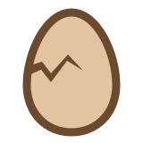
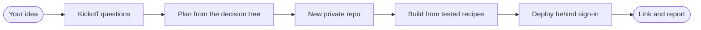

  

<h1 align="center">hatchery</h1>

<strong>Hand Claude an idea. Get a deployed app.</strong>

  
  
  
  
  

Hatchery turns Claude Code on the web into a build system for personal projects. Open a session on this repo, describe an idea in a sentence, answer a few questions, and the session creates a private repo, builds the app with tests, deploys it behind a sign-in, checks it on a phone screen, and reports back with a link. From your phone, if you like.

## How it works

1. **Kickoff.** The session asks what you're building, what done means, what data it keeps, and whether it needs AI. Each question comes with a suggested answer, so "yes" is often enough.
2. **Plan.** It walks the [decision tree](DECISION-TREE.md) and climbs only as far as the project needs: a static page with browser storage first, then a Worker, D1, R2 or Postgres when there is a reason.
3. **Build.** A workflow creates the repo. The session copies in the tested [recipes](recipes/README.md) the tree picked and builds on top of them. Every commit runs the tests.
4. **Ship.** It deploys a Preview, looks at it on a phone viewport, opens a PR, and reports. You try it and merge.

The full playbook the session follows is [CLAUDE.md](CLAUDE.md).

## What every project gets

- **Private by default.** Cloudflare Access sign-in plus `noindex` everywhere. Public only when you say.
- **Tests that gate commits.** Unit and end-to-end tests on phone and desktop, in a pre-commit hook and in CI.
- **A status page** showing what was built and how that exact build was verified, screenshots included.
- **Your data kept safe.** Versioned saved data, migrations, fixtures for every past shape, export and import.
- **A privacy check** that scans the build before every deploy: only an allowlist of files ships.
- **Free tier only.** Anything that needs a payment method stops and asks you first.
- **Commits credited to you,** under your GitHub no-reply address.

## Get started

You need a GitHub account, Claude Code on the web, and about an hour.

1. Fork this repo and keep the name `hatchery`.
2. Follow [SETUP.md](SETUP.md): Cloudflare, Neon, two tokens, and one cloud environment that holds everything personal.
3. Open a session on your fork in the `hatchery-build` environment and say: *"New project smoke-web: a one-page list app. Take every default."*

Your name, email, GitHub account and domain live only in your cloud environment. The repo names the variables, never the values, so your fork needs no edits.

## What's inside

| Path | What it is |
| --- | --- |
| [CLAUDE.md](CLAUDE.md) | The playbook every session follows. |
| [DECISION-TREE.md](DECISION-TREE.md) | How a project picks its architecture, with free-plan limits. |
| [recipes/](recipes/README.md) | Tested project files: `base`, `web`, `web-storage`, `pwa`. |
| [SETUP.md](SETUP.md) | One-time setup: accounts, tokens, the cloud environment, smoke tests. |
| [DECISIONS.md](DECISIONS.md) | Why hatchery works the way it does, and what was tested. |
| [CHANGELOG.md](CHANGELOG.md), [VERSION](VERSION) | Convention versions. Projects record theirs and ask before updating. |
| `.github/workflows/` | `create-project` makes repos, `project-secret` sets their secrets, `recipes` tests the recipes. |
| `scripts/` | Composing a project, checking a session, Cloudflare Access, sealing secrets. |

## Limits

- **Web first.** Cloud sessions run on Linux, so native macOS and iOS apps can't be built there. The tree says what to do instead.
- **One person's projects.** Hatchery is built for personal apps, not team products.
- **Free plans move.** Limits in the decision tree were checked in October 2026.

## Credits

`.claude/skills/karpathy-guidelines/` is vendored unchanged from [forrestchang/andrej-karpathy-skills](https://github.com/forrestchang/andrej-karpathy-skills) at commit [`2c606141936f1eeef17fa3043a72095b4765b9c2`](https://github.com/forrestchang/andrej-karpathy-skills/tree/2c606141936f1eeef17fa3043a72095b4765b9c2), MIT license. It is a community skill based on Andrej Karpathy's observations about LLM coding, not written by him. Every new project gets a copy.

## License

[MIT](LICENSE).
